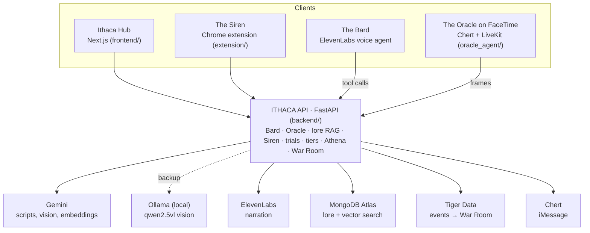

# ITHACA: every fan's road home to FaZe

**HackUTA 2026 · FaZe Clan challenge**

FaZe started in 2010 as a few kids uploading Call of Duty trickshots. Sixteen years later, the fans who grew up on it have drifted away, and a new generation doesn't know why FaZe ever mattered. That's the *Odyssey*: a long voyage home.

ITHACA brings both back. Returning fans are **Odysseus** ("you were there"). New fans are **Telemachus** (searching for the legend they missed). You talk to **the Bard**, who sings your personal FaZe history. You FaceTime **the Oracle**, who recognizes your old merch or judges your trickshot. **The Siren**, a Chrome extension, turns every FaZe video on YouTube and Twitch into a layer of lore and collectible relics. **Athena** guides you through all of it, and the **War Room** shows FaZe how it makes money.

---

## The journey

The home page first asks: **new or returning?** Returning fans go straight to the Bard. New fans watch **"FaZe in 40 seconds"**, a story-style montage from 2010 trickshots to today, narrated in the Bard's ElevenLabs voice (every line from the curated lore), then start their Odyssey as Telemachus with their journey set to 2026.

Athena (the 🦉 in the corner) walks every fan through seven steps and ticks them off as they happen.

| # | Step | What happens | Built with |
|---|---|---|---|
| 1 | **Meet the Bard** | Talk for 60 seconds ("When did you find FaZe? Who was your guy?"). The Bard classifies you as Odysseus or Telemachus and draws your **Odyssey Map** with your entry era glowing. | ElevenLabs Agents, Gemini |
| 2 | **Return to your era** | Tap any era on the map (2010 Trickshots, 2013 Rug Era, 2020 Nuke Squad, 2022 Snoop, Today) to see that era's FaZe Clan videos. | FastAPI, lore DB |
| 3 | **Hear the Siren** | Open a video on YouTube. The Siren slides in with the story behind that moment, a **relic** to collect for **Drachmae** (points) and a hint for the next relic to find. Works on FaZe member channels too (Rug, Swagg, Jarvis…). Back on the Hub, the relic shows up live. | Chrome extension (MV3) |
| 4 | **Prove it to the Oracle** | Hold your FaZe merch up to the camera (or FaceTime the Oracle). *Argos Remembers* names the item, dates it ("2014 · Rug Era"), says which clue gave it away, and grants that era's relic. | Gemini vision (local Ollama backup), Chert |
| 5 | **The Bard's song** | A 60–90 second episode about your era, grounded only in curated, sourced lore, narrated over the real FaZe clip playing in the page. Watching 30 seconds of the clip earns its relic. | Gemini RAG, ElevenLabs TTS, YouTube player |
| 6 | **String the bow** | The weekly **Bow Trial**: show your best trickshot. The Oracle scores it, runs a safety check, and ranks you among **the Suitors**. Brands can sponsor the week. | Gemini vision |
| 7 | **Claim your reward** | **Tiers**: Traveler (1 relic), Sailor (5), Hero (10), Legend (20) unlock a badge, wallpapers, early Era Drop access and Legend-only merch. The **Odyssey Pass ($4.99)** unlocks a monthly meet & greet draw with your FaZe favorite. | FastAPI |

Also: a shareable 15-second vertical **recap video** of your Odyssey, a **Daily Omen** lore question (also over iMessage), and **live Bow Trials on Twitch** (`!bow` in chat).

### How it makes money (the War Room)

The War Room is FaZe's business dashboard. It shows:
- three revenue lines: the **Odyssey Pass** ($4.99/season), **Sponsored Bow Trials**, and **Era Drops** (merch reprints shaped by fan demand);
- **reactivated fans** over time and the funnel from Bard to Pass;
- **era-drop demand**: which eras fans collect the most.

The charts use clearly labeled simulated history until real traffic arrives.

---

## Architecture



**Only the backend talks to the AI and data services.** Every client just calls the API. Every service is optional, and each has a fallback so the demo never goes silent:

- **Oracle and Bard scripts:** Gemini → local Ollama model → labelled canned answer
- **Narration:** ElevenLabs → Gemini TTS (free tier, same key) → the computer's built-in voice (episodes only) → the browser reads the script
- **Lore search:** Atlas vector search → keyword search
- **Database:** Tiger Data → in-memory store
- **Hub:** if the backend can't be reached, Athena and the era videos still work from the browser

| Service | Role in ITHACA |
|---|---|
| **Gemini** | Writes Bard episodes from retrieved lore (RAG), judges Oracle frames (structured JSON verdicts), answers "Ask the Bard", embeds lore |
| **Ollama** (local, no key) | Backup vision/text model when Gemini fails or runs out of quota |
| **ElevenLabs** | The Bard's voice: the live onboarding agent, plus narration (TTS) for episodes |
| **Chert** | FaceTime the Oracle from your own phone; iMessage relic cards and the Daily Omen |
| **MongoDB Atlas** | Lore and vector search |
| **Tiger Data** | Time-series events and continuous aggregates powering the War Room |
| **Vultr + GoDaddy** | Hosting (Caddy + systemd) and the domain |
| **YouTube Data API / Twitch EventSub** | FaZe uploads for the Siren; live Bow Trials from Twitch chat |

### Repo layout

```
backend/        FastAPI API (Part A): app/services/* (bard, oracle, lore, store, rewards, quest, recap, chert, ...)
  data/         lore_seed.json (31 curated, sourced FaZe moments) and merch_reference.json (verified merch per era for the Oracle)
  scripts/      load_lore, ingest_youtube, setup_bard_agent, bard_doctor, pregen_episodes, seed_tiger, chert_subscribe, ...
  static/       test.html (API test page), oracle_cam.html, bard.html, twitch.html
  tests/        pytest suite (43 tests, run with no keys)
frontend/       Ithaca Hub + War Room (Next.js 15, Tailwind 4, Framer Motion, Recharts)
extension/      The Siren (Chrome MV3 side panel)
oracle_agent/   LiveKit worker that Chert bridges FaceTime calls into
ops/            Vultr setup, Caddy, systemd, one-command redeploy
setup/          one-command setup and start scripts (Windows .ps1, macOS/Linux .sh)
docs/           Part B and Part D guides, Siren setup, privacy notes, Devpost draft
```

---

## Run it locally

### 0. Prerequisites

- **Python 3.11+**, **Node.js 20+**, **Git**, **Chrome**
- Optional: **FFmpeg** for recap videos (`winget install Gyan.FFmpeg` / `brew install ffmpeg`)
- Optional: **[Ollama](https://ollama.com)** for the local backup AI (`ollama pull qwen2.5vl:3b`)

```bash
git clone https://github.com/SameeraaGKan/Ithica.git
cd Ithica
git checkout main && git pull
```

**Shortcut: one command each.** The setup script installs everything, creates your `.env` files and runs the tests. The dev script starts the backend (8080) and the Hub (3000) together. Or follow steps 1–2 by hand.

```bash
# Windows (PowerShell)
powershell -ExecutionPolicy Bypass -File setup\setup.ps1
powershell -ExecutionPolicy Bypass -File setup\dev.ps1
# macOS / Linux
bash setup/setup.sh && bash setup/dev.sh
```

### 1. Backend: the API (window 1)

```bash
cd backend
python -m venv .venv
# Windows: .venv\Scripts\activate      Mac/Linux: source .venv/bin/activate
pip install -r requirements.txt
cp .env.example .env                    # Windows: copy .env.example .env
uvicorn app.main:app --reload --host 127.0.0.1 --port 8080
```

Check it:
- http://127.0.0.1:8080/health shows which services are live
- http://127.0.0.1:8080/docs is every endpoint, clickable
- http://127.0.0.1:8080/test is a plain page that exercises the whole flow

> `--reload` only watches code. **After editing `.env`, stop the server (Ctrl+C) and start it again.**

### 2. Hub: the website (window 2)

```bash
cd frontend
npm install
echo NEXT_PUBLIC_API_URL=http://127.0.0.1:8080 > .env.local
npm run dev
```

On Windows PowerShell, write `.env.local` this way, so Next.js can read it:
`Set-Content -Path .env.local -Value "NEXT_PUBLIC_API_URL=http://127.0.0.1:8080" -Encoding ascii`

Open **http://localhost:3000** and click **Enter as demo fan**. Each page shows **● Live** when it's reading from the backend.

### 3. The Siren: Chrome extension

1. Go to `chrome://extensions`, turn on **Developer mode**, click **Load unpacked**, and pick the `extension/` folder.
2. Pin **The Siren**. Open any FaZe video on YouTube and click the icon.
3. In **⚙ settings**, set API base to `http://127.0.0.1:8080` and Fan ID to `demo_odysseus`, then **Save**. The status should read **Live · Ithica API**.

More detail and fixes: [`docs/SIREN_SETUP.md`](docs/SIREN_SETUP.md).

### 4. Add keys (all optional)

Put them in `backend/.env`, then restart the backend.

| Variable | Turns on | Notes |
|---|---|---|
| `GEMINI_API_KEY` | Real episodes, Oracle vision, transcript classification, embeddings | Free at aistudio.google.com. `GEMINI_MODEL` defaults to `gemini-3.5-flash` |
| `ELEVENLABS_API_KEY` + `ELEVENLABS_VOICE_ID` | Bard narration (TTS) | The key needs **Text to Speech** access (and **Agents: Write** for the voice agent) |
| `ELEVENLABS_AGENT_ID` | Voice onboarding on the Hub | Created by `python -m scripts.setup_bard_agent` (see below) |
| `PUBLIC_BASE_URL` | Public URL of this API | `http://127.0.0.1:8080` locally; a tunnel or `https://api.<domain>` when ElevenLabs or Chert must reach it |
| `MONGODB_URI` | Atlas vector search for lore | Then `python -m scripts.load_lore` and create the index from `scripts/atlas_vector_index.json` |
| `TIGER_DSN` | Durable events + War Room aggregates | `psql "$TIGER_DSN" -f sql/schema.sql`, then `python -m scripts.seed_tiger` |
| `CHERT_API_KEY`, `CHERT_LINE`, `CHERT_WEBHOOK_SECRET` | iMessage | Without a key, messages are a dry run, readable at `/chert/outbox` |
| `YOUTUBE_API_KEY` | `scripts.ingest_youtube` | Pulls FaZe uploads and suggests a video for each lore entry |
| `TWITCH_*` | Live Bow Trials | `python -m scripts.twitch_subscribe --broadcaster <you>` |
| `ITHACA_API_KEY` | Locks agent/webhook/admin routes | Callers send the `X-Ithaca-Key` header |
| *(Ollama, no key)* | Local backup AI for the Oracle and Bard scripts | Install [Ollama](https://ollama.com), then `ollama pull qwen2.5vl:3b`. Used when Gemini fails or runs out of quota. Order set by `ORACLE_PROVIDERS` / `TEXT_PROVIDERS` (default `gemini,ollama`) |
| `TOKEN_SECRET` | Signs fan tokens and keys the phone-number hash | Set a long random value before the demo |

With no keys and no Ollama the app still runs end to end: the Oracle gives labelled offline verdicts (kept off the Suitors board), the Bard uses templates, and narration falls back to the computer's built-in voice. Privacy details are in `docs/PRIVACY_NOTES.md`; a fan's data can be erased with `DELETE /fan/{fan_id}/data`.

### 5. The Bard's voice (ElevenLabs agent)

The agent calls the API mid-conversation, so the API needs a **public URL**:

```bash
cloudflared tunnel --url http://127.0.0.1:8080      # prints https://….trycloudflare.com; keep it open
# backend/.env: PUBLIC_BASE_URL=https://….trycloudflare.com
cd backend && python -m scripts.setup_bard_agent      # prints ELEVENLABS_AGENT_ID=…; add it to .env
```

Restart the backend. The mic on `/onboard` should read **Tap to begin**. If the tunnel URL changes, update `PUBLIC_BASE_URL` and rerun the script: it updates the existing agent.

### 6. The Oracle on FaceTime (Chert)

See [`docs/part-b-voice-facetime.md`](docs/part-b-voice-facetime.md). Short version: `cd oracle_agent && pip install -r requirements.txt`, fill in `.env.local`, run `python agent.py dev`, then `chert dev --agent ithaca-oracle`, and FaceTime the line. **Fallback on stage:** the same Oracle runs on the laptop camera at `/oracle-cam` on the Hub.

### 7. Before the demo

```bash
cd backend
python -m scripts.pregen_episodes     # caches every era × path episode + the montage narration (audio when ElevenLabs is keyed)
pytest -q                             # 43 tests, no keys needed
```

---

## Demo script (≈3 minutes)

1. **Home → "I've been here before" → Talk to the Bard** (or **Enter as demo fan** if the Wi-Fi is shaky). To show the new-fan side, pick **"I'm new to FaZe"** for the 40-second montage. "When did you find FaZe?" The map appears: *"You were there."*
2. **Tap 2013 · Rug Era.** The era's FaZe Clan videos appear. Open one.
3. **On YouTube, the Siren slides in** with the story behind that moment. **Collect Relic.** Switch back: the relic and Drachmae are already on the Hub.
4. **Prove it to the Oracle.** Hold up a FaZe hoodie. The Oracle names the item and year, says the clue it dated it by, and grants the relic. (On FaceTime, the relic card arrives by iMessage.)
5. **The Bard's song** plays over the FaZe clip. Then the **Bow Trial**: score, rank among the Suitors.
6. **Tiers**: relics → rewards. The Pass unlocks the meet & greet draw.
7. **War Room**: three revenue lines, reactivated fans, era-drop demand. *"FaZe doesn't need new fans or old fans. It needs both, and ITHACA brings them home together."*

---

## Troubleshooting

| Symptom | Fix |
|---|---|
| Hub pages say **Mock** | `frontend/.env.local` is missing or unreadable (on Windows, write it with `Set-Content … -Encoding ascii`), or the backend isn't running on 8080 |
| The Bard greets you but **can't hear you** / hangs up | Re-run `python -m scripts.setup_bard_agent` (re-applies speech recognition + transcript events), restart the backend, try again. Then `python -m scripts.bard_doctor` shows exactly what ElevenLabs heard on your last calls. During a call you can also type to the Bard. |
| `/health` shows a key as `false` after adding it | Restart the backend: `--reload` doesn't pick up `.env` changes |
| Oracle says **FALLBACK** | Gemini failed. The backend terminal prints why; usually a bad key or an outdated `GEMINI_MODEL` |
| `quota_exceeded` from ElevenLabs | Free credits are used up for the month. Narration switches to Gemini TTS automatically. Spend credits on what you'll show: `python -m scripts.pregen_episodes --intro-only` voices just the montage. `ELEVENLABS_MODEL=eleven_flash_v2_5` (the default) costs half per character |
| Episode has no ElevenLabs voice | The API key lacks **Text to Speech**; the backend logs `elevenlabs tts failed …`. The Hub reads the script with the browser voice meanwhile. Delete `backend/static/episodes.json` to regenerate |
| `setup_bard_agent`: `missing the permission convai_write` | Give the ElevenLabs key **Agents: Write** (or remove the restrictions) |
| Siren stuck on **Offline lore** | ⚙ settings: API base `http://127.0.0.1:8080`, then **Save**. Reload the extension after a `git pull` |
| Athena stuck on a step | Use **Done, next step →**; the Siren step needs the extension collecting for the same Fan ID |
| Athena or the era videos missing | `git pull`, check `frontend/.env.local` points at `http://127.0.0.1:8080`, restart both servers |
| Bow Trial score shows but isn't on the Suitors board | It was an offline verdict (no Gemini or Ollama reached), so no safety check ran. Fix the Gemini key or start Ollama |
| Oracle is slow the first time with Ollama | The first call loads the model into memory (several seconds). Later calls are faster |
| Episode clip doesn't play | The lore has no `video_id` for that moment yet; the Bard card and a YouTube link show instead |
| Hydration warning in the console | A browser extension modified the page. Demo in Incognito |

---

## Deploy

### Easiest: Render (API) + Vercel (Hub), about 15 minutes, free

**1. API on Render.** [render.com](https://render.com) → **New → Blueprint** → pick this repo. It reads `render.yaml` and builds `backend/Dockerfile` (ffmpeg included).
   - Paste your keys when asked (Gemini, ElevenLabs, MongoDB, Tiger; leave any you don't have empty).
   - Once it's live, copy its address (`https://ithaca-api-xxxx.onrender.com`), set **`PUBLIC_BASE_URL`** to it in Render's Environment tab, and redeploy. Check `/health`.
   - That public address also replaces the cloudflared tunnel: rerun `python -m scripts.setup_bard_agent` locally with `PUBLIC_BASE_URL` set to it, so the Bard's tools point at Render.

**2. Hub on Vercel.** [vercel.com](https://vercel.com) → **Add New → Project** → import this repo.
   - **Root Directory:** `frontend` (Next.js is detected automatically).
   - **Environment variable:** `NEXT_PUBLIC_API_URL` = your Render address. Deploy.

**3. Siren.** In its ⚙ settings, set API base to the Render address and Web base to the Vercel address.

Notes: the free Render plan sleeps after 15 idle minutes (the first request then takes ~50 s), so open `/health` a minute before the demo. Its disk is wiped on each deploy: without `TIGER_DSN` fans and relics reset, and cached audio is regenerated (run `pregen_episodes --intro-only` locally against it, or just open the montage once). The local Ollama backup isn't available there, so `render.yaml` sets the providers to Gemini only.

### Vultr (sponsor track, your own server + domain)

```bash
# on a fresh Ubuntu VM, with the DNS A record for api.<domain> pointing at it
DOMAIN=api.yourdomain.com bash ops/vultr_setup.sh
nano /etc/ithaca.env && systemctl restart ithaca-api
sudo bash /opt/ithaca/ops/redeploy.sh          # every redeploy
```

Caddy gets HTTPS automatically. Details: [`docs/siren-data-ops.md`](docs/siren-data-ops.md).

---

## Team

| | Role |
|---|---|
| **Sameeraa** | A: backend + AI (FastAPI, Gemini, RAG, Bard pipeline, Oracle verdicts, integration) |
| **Destiney** | B: voice + FaceTime (ElevenLabs agent, Chert FaceTime and iMessage) |
| **Carolyn** | C: frontend (Ithaca Hub, War Room) |
| **Debbie** | D: the Siren extension, curated lore, data and ops |

FaZe Clan names, logos and videos belong to FaZe Clan. Videos are embedded or linked from FaZe's own channels, never re-hosted.
